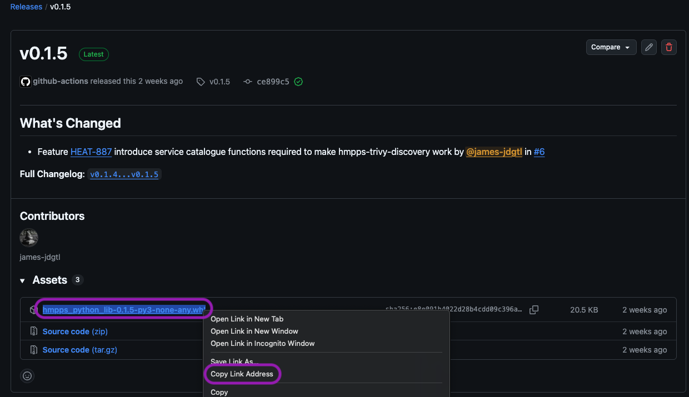

# hmpps-sre-python-lib

A set of shared Python libraries for use in HMPPS SRE projects.

## Overview
This library provides common clients and models for interacting with HMPPS infrastructure, including GitHub, Slack, SharePoint, and the Service Catalogue.

## Getting Started

### Prerequisites
You need to have [uv](https://docs.astral.sh/uv/) installed to manage Python libraries and environments.

```bash
# macOS (Homebrew)
brew install uv
```

Because `uv` creates a virtual environment (`.venv`) when `uv sync` is run, it's possible to activate this environment using

```
source .venv/bin/activate
```
and `python your_script.py` can be used as usual.


## Using hmpps-sre-python-lib in projects

### Github Actions Workflows

Any Github Action or Workflow running python will need the uv installation as well - that's as easy as swapping out the existing `actions/setup-python` section with `

```
  - name: Install uv & set Python
    uses: astral-sh/setup-uv@v6
    with:
      python-version: '3.13'
      enable-cache: true
      cache-dependency-glob: 'uv.lock'   # cache invalidates on lockfile change
```

and then replacing any invocation of `python ...` with `uv run python ...` eg:

```
    run: uv run python scripts/actions_check_sc_requests.py >> "$GITHUB_OUTPUT"
```

### Docker Images

In general, an image like `ghcr.io/ministryofjustice/hmpps-python:python3.13-alpine` will be used for existing Python scripts

The most convenient way to support uv within a Docker container is to use the pre-packaged uv image, so:

`ghcr.io/ministryofjustice/hmpps-python:python3.13-alpine` or `ghcr.io/astral-sh/uv:python3.13-bookworm-slim`

If the python application has been developed locally (see [migration](#migrating-to-hmpps-sre-python-lib) below), a `pyproject.toml` file will already exist, in which case it's simply a case of adding these lines to the Dockerfile:

```
COPY pyproject.toml .
RUN uv sync
```

The entrypoint will also need to be updated, from (for example):

```
CMD [ "python", "-u", "github_discovery.py" ]
```

to:
```
CMD [ "uv" "run"  "python", "-u", "github_discovery.py" ]
```

### Proxy Support For Outbound Requests

Outbound HTTP requests made by this library automatically respect proxy settings from the environment.

Set one or both of these variables in your runtime environment:

```
HTTP_PROXY=http://your-proxy:port
HTTPS_PROXY=http://your-proxy:port
```

The library applies these values to `requests` calls (including shared sessions), and SDK clients (for example Slack and SharePoint Graph) use the same environment proxy settings.

## Patching this repository

Because this library forms the basis of many of our discovery and utility scripts, we need to make sure it remains up-to-date, tackling vulnerabilties and dependency updates in good time.

If a core project module requires updating, follow the guidance in Dependabot.
It may be that a vulnerability is discovered in a subcomponent. Running `uv sync` isn't enough to pick up the latest versions.

For a specific library (for example ***Werkzeug*** in [this alert](https://github.com/ministryofjustice/hmpps-sre-python-lib/security/dependabot/5)), you can carry out a comamnd like this:

```
uv lock -P werkzeug
uv sync
```

If the dependency graph for the app uses '>=', it will update to the latest supported version. Either way, check the latest version of `uv.lock` to confirm that the version is not affected by the vulnerability.

For a broad refresh, you can use
```
uv lock -U
uv sync
```

When the PR is merged, it will retain the existing tag. It will require redeployment of the utilities and scripts that use the libraries to pick up the latest verions.


## Cloning this repository

If you're cloning this repository for the first time, you'll need to run

```
uv sync
```
to ensure your local environment matches the requirements of the project. 
In fact, every time you pull down or refresh the project, it's worth running `uv sync` to make sure it's up-to-date with the latest version.


## Updating the library

# Other platforms
curl -LsSf https://astral.sh/uv/install.sh | sh
```

### Local Development
1.  **Clone the repository**:
    ```bash
    git clone https://github.com/ministryofjustice/hmpps-sre-python-lib.git
    cd hmpps-sre-python-lib
    ```
2.  **Initialize the environment**:
    ```bash
    uv sync
    ```
    This creates a virtual environment (`.venv`) and installs all dependencies from `uv.lock`.
3.  **Activate the environment**:
    ```bash
    source .venv/bin/activate
    ```
    Now you can run scripts or tests using `python` as usual, or use `uv run python your_script.py`.

## Using this library in your project

### 1. Adding the dependency
Every published wheel is served from a [PEP 503](https://peps.python.org/pep-0503/)
simple index at `https://ministryofjustice.github.io/hmpps-sre-python-lib/simple/`.
Using it as a package index (rather than a direct wheel URL) lets `uv` resolve
versions and lets Dependabot raise update PRs.

Add the index to your `pyproject.toml`, marked `explicit` so it is only used for
this library:

```toml
dependencies = [
    "hmpps-sre-python-lib>=1.3.10",
]

[[tool.uv.index]]
name = "hmpps-sre"
url = "https://ministryofjustice.github.io/hmpps-sre-python-lib/simple/"
explicit = true

[tool.uv.sources]
hmpps-sre-python-lib = { index = "hmpps-sre" }
```

Then run `uv lock` (or `uv add "hmpps-sre-python-lib>=1.3.10"` once the index
and source are configured).

To let Dependabot update the library, add the index as a registry in
`.github/dependabot.yml`. The index does not publish upload times, so exclude
the library from any `cooldown`:

```yaml
version: 2
registries:
  hmpps-sre:
    type: python-index
    url: https://ministryofjustice.github.io/hmpps-sre-python-lib/simple/
updates:
  - package-ecosystem: uv
    directory: /
    registries:
      - hmpps-sre
    schedule:
      interval: weekly
    cooldown:
      default-days: 7
      exclude:
        - hmpps-sre-python-lib
```

Individual wheels are also listed on the
[downloads page](https://ministryofjustice.github.io/hmpps-sre-python-lib/) and
can still be used as direct URL sources, but Dependabot cannot update those.

For `pip`:

```bash
pip install --extra-index-url https://ministryofjustice.github.io/hmpps-sre-python-lib/simple/ hmpps-sre-python-lib==1.3.10
```

The shared Ruff configuration is available as
[`ruff.toml`](https://ministryofjustice.github.io/hmpps-sre-python-lib/ruff.toml).
Existing GitHub Release assets remain available to authenticated repository readers.

### 2. Usage in GitHub Actions
Swap out `actions/setup-python` for `astral-sh/setup-uv`:

```yaml
- name: Install uv & set Python
  uses: astral-sh/setup-uv@v6
  with:
    python-version: '3.13'
    enable-cache: true
    cache-dependency-glob: 'uv.lock'

- name: Run script
  run: uv run python scripts/my_script.py
```

### 3. Usage in Docker
For HMPPS Python projects, you can use the MOJ standard images or the official `uv` image.

**Standard Images:**
- `ghcr.io/ministryofjustice/hmpps-python:python3.13-alpine`
- `ghcr.io/astral-sh/uv:python3.13-bookworm-slim`

To support `uv` in your Dockerfile:

```dockerfile
COPY pyproject.toml uv.lock ./
# If using a non-uv image, you'll need to install uv first
RUN uv sync --frozen
# Example entrypoint
CMD [ "uv", "run", "python", "-u", "my_script.py" ]
```

## Contributing

### Making Changes
1.  **Add dependencies**: Use `uv add <library>` to update `pyproject.toml` and `uv.lock`.
2.  **Documentation**: Update relevant files in the `docs/` folder if you add new features.
3.  **Formatting**: This project uses `ruff`. You can install Husky to enable pre-commit hooks:
    ```bash
    npm install husky --save-dev
    ```
4.  **Validation**: Test your changes in another project before merging. You can point `uv` directly at your branch:
    ```bash
    uv remove hmpps-sre-python-lib
    uv add "hmpps-sre-python-lib @ git+https://github.com/ministryofjustice/hmpps-sre-python-lib.git@your-branch-name"
    uv sync
    ```

    *Note: If validating on a deployed Docker container, you may need to ensure `git` is installed (e.g., `RUN apk add --no-cache git`).*

### Releasing a new version
This repository uses automated releases via GitHub Actions.

1.  **Update the version** in `pyproject.toml` (following [SemVer](https://semver.org/)).
2.  **Update `CHANGELOG.md`** with your changes.
3.  **Sync the lockfile**: Run `uv lock`.
4.  **Commit and push** to your branch.
5.  **Merge the Pull Request** into `main`.

Once merged, the release workflow will automatically:
- Create a Git tag (e.g., `v1.2.9`).
- Create a GitHub Release.
- Build and upload the Python wheel asset.
- Preserve the wheel on the `gh-pages` branch and deploy the downloads page.

The [release workflow](.github/workflows/push_libs.yml) handles both manually
pushed version tags and calls from the merge workflow. It publishes only wheels,
`ruff.toml`, a download index, and a PEP 503 simple index (`/simple/`) generated
from every wheel in the archive. Older wheels already on `gh-pages` are retained;
existing release assets are not automatically backfilled.

### Pages setup

- Keep the `gh-pages` branch available as the wheel archive; no branch-based Pages
  build is needed.
- In **Settings > Pages**, set **Source** to **GitHub Actions** (already configured).
- Ensure the `github-pages` environment's deployment rules allow version tags
  matching `v*.*.*`. Merge-triggered publication runs against `main`, so allow
  that branch too.
- Allow Actions to write repository contents and deploy Pages.
- Keep the Pages site **public** if anonymous `pip`/`uv` downloads are required.
  An internal repository can have a public Pages site when enterprise policy
  permits it. Wheels contain Python source: making the repository internal does
  not make the published library private. Private Pages requires browser-based
  authentication and is not a drop-in package endpoint.

The archive retains older wheels, while `ruff.toml` tracks the most recently
published release. Only new publications appear on Pages; migrate consumers'
existing release URLs to the corresponding Pages URLs once those wheels have
been published.



## Maintenance

### Patching Vulnerabilities
If Dependabot alerts you to a vulnerability, or you need to refresh dependencies:

```bash
# Refresh a specific library
uv lock -P werkzeug
# Refresh all libraries
uv lock -U
# Sync environment
uv sync
```

---

## Migration Guide
If you are moving an existing project to use `hmpps-sre-python-lib`:

1.  **Initialize uv**: `uv init`
2.  **Import requirements**: `uv add -r requirements.txt`
3.  **Add this library**: Find the latest wheel in [Releases](https://github.com/ministryofjustice/hmpps-sre-python-lib/releases) and run:
    ```bash
    uv add <release-url-to-wheel>
    ```
4.  **Rewrite & Clean up**: Update your imports to use the shared library and remove local copies of those files - and `requirements.txt` can go, too, since it's not longer used.
5.  **Qualify Imports**: The library is imported via `hmpps`. Example: `from hmpps.clients.github import GithubSession`.
6.  **Fine-tuning Dependencies**: Remove unnecessary packages from `pyproject.toml` (like `requests` or `slack-sdk`) if they are already provided by this library. This avoids version clashes like:
    ```text
    × No solution found when resolving dependencies:
    ╰─▶ Because your project depends on hmpps-sre-python-lib and requests==2.32.4, 
        and hmpps-sre-python-lib depends on requests>=2.32.5, resolution failed.
    ```
7.  **Troubleshooting Pylance**: If Pylance can't locate libraries despite `uv sync`:
    - Delete the `.venv` directory.
    - Run `uv sync` to recreate it.
    - Restart VS Code if necessary.
